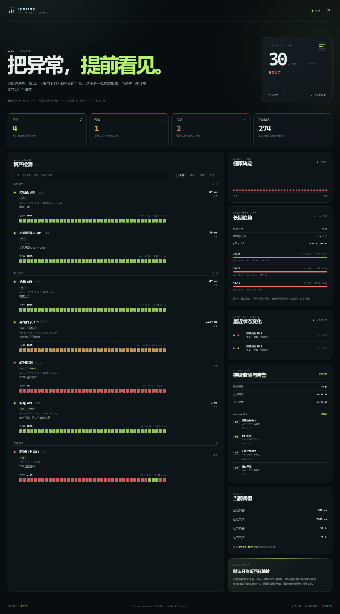
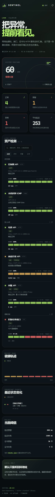
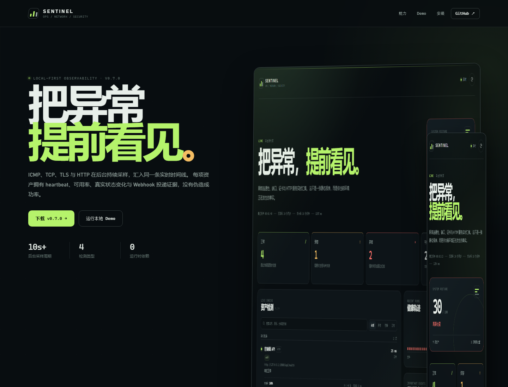

<div align="center">



# Sentinel · 运维健康看板

**把异常，提前看见。**

一个零依赖、默认只监听本机的运维健康看板。ICMP、TCP、TLS 与 HTTP 检测在后台持续采样，汇入同一条可信时间线，并为每项资产保留 heartbeat、可用率、状态变化和 Webhook 投递证据。

[GitHub Actions](https://github.com/CiallorZ/ops-health-dashboard/actions/workflows/ci.yml)
· [Python 3.11+](https://www.python.org/)
· [MIT License](LICENSE)
· [v0.11.1](VERSION)

[下载 v0.11.1](docs/downloads/sentinel-0.11.1.zip)
· [介绍页](docs/index.html)
· [架构与方向](docs/ARCHITECTURE.md)
· [安全边界](docs/SECURITY.md)
· [测试说明](docs/TESTING.md)
· [发布流程](docs/RELEASE.md)
· [路线图](ROADMAP.md)

</div>

---

## 这是什么

Sentinel 面向“先自己看见，再等人投诉”的场景：本机或内网里跑一个小服务，按配置持续检查关键资产，并把真实证据放在一屏里。

**目标**是把它做成自托管的**综合运维监控内核**——在同一套证据模型下覆盖主机、网络、数据库、中间件、容器 / K8s、AIoT 与安全基线，对标 Uptime Kuma 的“一屏看清 + 状态迁移即告警”闭环体验。

**当前已实现**的是网络域的黑盒存活探测（ICMP / TCP / TLS / HTTP）及其配套的调度、告警、趋势、证书、留存与维护窗口。**主机资源、数据库、中间件、K8s、AIoT、安全基线属于规划中的 Phase B，尚未实现**——下面的能力清单只列已落地的部分，路线见 [ROADMAP.md](ROADMAP.md) 与 [docs/ARCHITECTURE.md](docs/ARCHITECTURE.md)。

它**不是**一个演示用的大屏，也不伪造成功率：

- 失败就是失败，重试恢复也会保留“曾经失败过”的证据；
- 每项结果都带延迟、状态码、证书天数或错误原因；
- 每项检查都有紧凑 heartbeat、近 40 轮可用率、标签与最近状态变化；
- 浏览器关闭后，后台调度仍按配置周期持续采样；
- 按真实 UTC 日聚合长期可用率，并给出 p50 / p95 延迟分位数；
- 证书到期日历只统计真实 TLS 握手返回的到期时间，按阈值分级并给出最近到期；
- 历史文件有硬上限：单文件 4 MiB、2 份归档、最多加载 5000 行，超出即轮转并如实标注截断；
- 状态变化可投递到 Webhook，并保留冷却、重试和最终送达结果；
- 计划维护窗口只抑制告警、不停止采样，账本会写明抑制原因；
- 离线报告会明确标注已测量、已跳过与未测量能力。

## 效果预览

| 桌面端 | 移动端 |
|---|---|
|  |  |

> 截图使用仓库内的 `examples/checks.showcase.json` 与 `examples/demo_targets.py` 在本地真实取样：4 项正常、1 项延迟预警、2 项异常（GitHub TLS 一次真实超时、旧版任务端口关闭）；“对账 API”在第 2 次尝试后恢复，GitHub 证书在受限重试后回到正常，状态变化与告警账本都来自真实采样。

## 为什么像 Uptime Kuma，但不是 Uptime Kuma

本项目借鉴了 [Uptime Kuma](https://github.com/louislam/uptime-kuma) 已经被验证过的监控闭环：

- 紧凑的监控列表、逐项 heartbeat 与一眼可读的状态色；
- 近 N 轮可用率、当前延迟、分组与标签；
- 搜索和状态筛选；
- 只展示真实状态变化的 “Important Events” 列表；
- 不依赖浏览器保持打开的后台定时监测；
- 状态迁移触发通知，避免把持续失败重复刷成告警风暴；
- 桌面列表 + 侧栏、移动端单列的响应式阅读方式。

Sentinel 是独立的 Python 标准库实现，不复制 Uptime Kuma 的 Vue / Socket.IO / 关系库架构，也没有内置账号与 90+ 通知矩阵。它优先解决“单机、自托管、可审计、默认只监听回环地址”的轻量场景；维护窗口、证书日历、长期趋势与告警账本已在 `v0.8`–`v0.10` 补齐。

两者的差距不在“功能多少”，而在**抽象层次**：Uptime Kuma 有 monitor 类型 + 断言 + 凭据体系，所以能监控数据库与容器；Sentinel 目前只有四类黑盒探测 + 延迟阈值。因此路线不是逐个抄功能，而是先补**域 / 探测 / 断言**三层内核（Phase A），再逐域落地（Phase B）。这是 [docs/ARCHITECTURE.md](docs/ARCHITECTURE.md) 第 1.2 节与第 5 节的内容。

## 介绍页

[](docs/index.html)

介绍页采用自包含 HTML，可直接本地打开，也可作为 GitHub Pages 的静态入口。发布前请先确认仓库 Pages 设置；本仓库不会自动部署线上站点。

## 核心能力

| 能力 | 说明 |
|---|---|
| 四类检测 | ICMP ping、TCP 端口、TLS 证书剩余天数、HTTP 状态码与延迟 |
| 可解释状态 | `ok` / `warn` / `fail`，保留原始错误、延迟、状态码与证书信息 |
| 受限重试 | 每项可选 `0–2` 次额外尝试；结果记录实际尝试次数与是否重试恢复 |
| 业务分组 | 按核心业务、遗留系统、外部依赖等分组呈现 |
| 后台调度 | 不依赖浏览器，按 `10–3600` 秒的周期持续采样；页面只读取最新快照 |
| 逐项 heartbeat | 每项检查保存最近 40 轮的 `id / status / latency_ms` 精简证据，不重复写入名称、URL 或错误详情 |
| 可用率与事件 | 页面展示每项近 40 轮可用率；仅当相邻真实采样状态变化时生成 Important Events |
| Webhook 告警 | 故障、降级与恢复可触发 JSON Webhook；支持冷却去重、有界重试与可选 HMAC-SHA256 签名 |
| 投递证据 | 最近告警显示排队、投递、重试、送达、失败或抑制结果，不暴露 Webhook URL 与签名秘密 |
| 长期趋势 | `/api/trends?days=1..30` 按真实 UTC 日聚合可用率与 p50/p95；缺失日期不补造 |
| 证书日历 | `/api/certificates` 按真实 `expires_at` 计算剩余天数，按 `tls_warn_days` / `tls_fail_days` 分级，最多 8 条、窗口 90 天 |
| 历史留存 | `history.jsonl` 单文件 4 MiB、2 份归档、最多加载 5000 行；超额轮转，截断在 API 与页面如实标注 |
| 快速定位 | 可按名称、目标、分组或标签搜索，并按 `ok / warn / fail` 筛选 |
| 离线报告 | `/api/report` 下载自包含 HTML，URL 凭据、查询参数与片段会被移除 |
| 有界超时 | 每项独立超时，单项故障不会拖垮整个看板 |
| 安全默认值 | 默认仅监听 `127.0.0.1`；CSP、`nosniff`、禁止 iframe；拒绝带凭据的 URL |
| 零构建链 | Python 标准库 + 原生 HTML/CSS/JS，无第三方运行时依赖 |
| 三端运行 | Windows 本机、Docker、任意 Python 3.11+ 环境 |

## 下载与安装

| 方式 | 适合场景 | 入口 |
|---|---|---|
| Windows 便携包 | 下载后直接运行，不需要构建 | [下载 `sentinel-0.11.1.zip`](docs/downloads/sentinel-0.11.1.zip) · [SHA256](docs/downloads/sentinel-0.11.1.zip.sha256) |
| Docker Compose | Linux 服务器或隔离环境 | 仓库根目录执行 `docker compose up --build -d` |
| 源码运行 | 开发、审计与自定义 | `git clone` 后执行 `python server.py` |

要求：**Python 3.11 或更高版本**，没有第三方 Python 运行时依赖。便携包已经包含源码、默认配置、演示替身和文档；解压后双击 `start-sentinel.cmd`，或执行：

```powershell
python server.py
```

```bash
# bash / macOS / Linux
python3 server.py
```

打开 <http://127.0.0.1:8080>。页面每 10 秒同步一次最新快照，检测由后台调度按 `monitor_interval_seconds` 持续执行；关闭浏览器不会停止监测。右上角按钮可立即触发一次手动采样。

```powershell
# 查看版本
python server.py --version

# 使用自定义配置与端口
python server.py --config checks.json --port 8080 --data-dir data

# 仅调试页面，不启动后台采样
python server.py --no-scheduler
```

便携包中的 `START-HERE.txt` 会重复给出最短安装路径。首次运行会在 `data/` 下创建有界历史与告警账本；不要把这些运行数据提交到 Git。

## 配置

所有资产都在 `checks.json` 中声明，修改后重启服务即可生效。

```json
{
  "version": 1,
  "monitor_interval_seconds": 60,
  "notifications": {
    "webhook_url": "http://127.0.0.1:18081/webhook",
    "signing_secret_env": "SENTINEL_WEBHOOK_SECRET",
    "cooldown_seconds": 300,
    "timeout_seconds": 4,
    "retry_attempts": 1
  },
  "thresholds": {
    "latency_warn_ms": 800,
    "latency_fail_ms": 2500,
    "tls_warn_days": 30,
    "tls_fail_days": 7
  },
  "maintenance_windows": [
    {
      "id": "release-window",
      "name": "结算服务发布窗口",
      "starts_at": "2026-10-21T02:00:00Z",
      "ends_at": "2026-10-21T04:00:00Z",
      "check_ids": ["api"],
      "suppress_alerts": true
    }
  ],
  "checks": [
    {
      "id": "api",
      "name": "生产 API",
      "group": "核心服务",
      "type": "http",
      "target": "https://example.com/health",
      "expected_status": [200, 204],
      "timeout_seconds": 5,
      "retry_attempts": 1,
      "tags": ["production", "api"]
    },
    {
      "id": "ssh",
      "name": "跳板机 SSH",
      "group": "基础设施",
      "type": "tcp",
      "target": "10.0.0.10",
      "port": 22,
      "timeout_seconds": 3
    },
    {
      "id": "cert",
      "name": "主站证书",
      "type": "tls",
      "target": "example.com",
      "port": 443,
      "timeout_seconds": 5
    },
    {
      "id": "gateway",
      "name": "网关 ICMP",
      "type": "ping",
      "target": "192.168.1.1",
      "timeout_seconds": 3
    }
  ]
}
```

| 字段 | 说明 |
|---|---|
| `id` | 唯一标识，只能使用字母、数字、`-`、`_` |
| `monitor_interval_seconds` | 后台采样周期，范围 `10–3600` 秒，默认 `60` |
| `type` | `http` / `tcp` / `tls` / `ping` |
| `target` | HTTP 为完整 URL；其余为主机名或 IP |
| `port` | `tcp` 必填；`tls` 默认 `443` |
| `expected_status` | HTTP 可接受状态码，默认 `[200]` |
| `verify_tls` | 是否验证证书链，默认 `true`；关闭会显著降低判断可信度 |
| `group` | 业务分组，默认 `未分组`，最多 80 个字符 |
| `timeout_seconds` | 单项超时，范围 `0.2–60` 秒 |
| `retry_attempts` | 失败后的额外尝试次数，范围 `0–2`，默认 `0`；单项最多执行 3 次 |
| `tags` | 可选字符串标签，用于展示与搜索 |
| `enabled` | 设为 `false` 可暂时停用单项 |
| `notifications.webhook_url` | 可选的 Webhook 地址；不要把带 Token 的 URL 写进仓库；也可改用 `webhook_url_env` |
| `notifications.signing_secret_env` | 可选的环境变量名；设置后发送 HMAC-SHA256 签名，变量值不会进入 API、报告或日志 |
| `notifications.cooldown_seconds` | 同一检查同一状态迁移的抑制窗口，`0–86400` 秒 |
| `notifications.timeout_seconds` | 单次 Webhook 请求超时，`0.2–30` 秒 |
| `notifications.retry_attempts` | Webhook 失败后的额外尝试次数，`0–2` |
| `maintenance_windows` | 有界维护窗口列表，最多 20 个，每个最长 30 天；时间必须带时区偏移 |
| `maintenance_windows[].check_ids` | 只对列出的检查生效；省略或空数组表示全部检查 |
| `maintenance_windows[].suppress_alerts` | 默认 `true`；设为 `false` 只展示窗口、不抑制告警 |

> **安全提醒**：不要在 `target`、名称或描述中写入密码、Token、Cookie 或带凭据的 URL。后端会拒绝 URL 内嵌凭据，但配置本身仍应保持干净。

> **告警秘密**：生产环境建议使用 `webhook_url_env` 与 `signing_secret_env`，不要把真实 Webhook URL 或签名秘密写进 `checks.json`。告警只在真实状态变化时触发：首次采样为失败、之后的状态迁移，以及故障恢复；状态未变化不会重复发送。

配置最多接受 **200 项检查**。这个上限同时约束单轮快照与历史条目的体积，避免无界放大。

## API

| 方法 | 路径 | 用途 |
|---|---|---|
| `GET` | `/api/health` | 进程存活与版本，不触发资产检测 |
| `GET` | `/api/status` | 获取缓存快照；`?force=1` 强制重新检测 |
| `GET` | `/api/history?limit=40` | 读取有界历史；新条目包含精简的逐项检查记录 |
| `GET` | `/api/config` | 只读配置，不含秘密 |
| `GET` | `/api/alerts?limit=12` | 读取脱敏的 Webhook 投递账本 |
| `GET` | `/api/trends?days=7` | 按真实 UTC 日读取有界可用率与 p50/p95；`days` 限制为 `1–30` |
| `GET` | `/api/certificates` | 读取真实 TLS 握手得到的有界证书到期日历 |
| `GET` | `/api/maintenance` | 读取进行中与即将开始的维护窗口、覆盖范围与告警抑制状态 |
| `GET` | `/api/report` | 下载当前快照的离线 HTML 报告 |
| `POST` | `/api/refresh` | 强制刷新并返回最新快照 |

`/api/status` 默认缓存 8 秒，避免多标签页制造重复检测；`force=1` 与 `POST /api/refresh` 会绕过缓存。响应中的 `automation.scheduler` 给出后台采样周期、上次/下次运行与错误类型，`automation.alerts` 给出脱敏的 Webhook 配置和最近投递结果。`history` 是整轮摘要，`check_history` 提供逐项 heartbeat、可用率、平均延迟与最近状态变化：

```json
{
  "automation": {
    "scheduler": {
      "running": true,
      "interval_seconds": 60,
      "last_completed_at": "2026-10-21T00:05:02Z",
      "next_run_at": "2026-10-21T00:06:02Z"
    },
    "alerts": {
      "configured": true,
      "signed": true,
      "pending": 0,
      "recent": [
        {
          "event": "recovered",
          "check_id": "api",
          "from_status": "fail",
          "to_status": "ok",
          "status": "delivered",
          "attempts": 1
        }
      ]
    }
  },
  "check_history": {
    "window": 40,
    "checks": {
      "api": {
        "samples": 12,
        "availability_percent": 91.7,
        "average_latency_ms": 48.2,
        "heartbeats": [
          {"status": "ok", "latency_ms": 32.1, "at": "2026-10-21T00:00:00Z"}
        ]
      }
    },
    "events": [
      {
        "check_id": "api",
        "name": "生产 API",
        "from": "fail",
        "to": "ok",
        "at": "2026-10-21T00:05:00Z"
      }
    ]
  }
}
```

可用率定义是“样本中非 `fail` 的比例”，`warn` 仍算可达但仍会显式标黄；它不是 SLA、时间加权可用率或持续采样承诺。旧版本留下的、没有 `checks` 字段的 JSONL 行仍可读取，只是不参与逐项计算。

`/api/trends` 的按天窗口是 UTC 日切，只返回有真实采样的日期；没有采样的日期不会出现，也不会被补造为空天。p50 / p95 由固定延迟桶插值得到，是对真实样本的分位数近似，不是精确排序统计。

`/api/certificates` 只统计 TLS 握手成功并返回 `expires_at` 的检查：剩余天数由“到期时间 − 当前 UTC 时间”重新计算，因此缓存快照不会冻结数字。握手失败、非 TLS 检查与畸形指标会被跳过，不会推测到期时间；`upcoming` 最多 8 条，只覆盖未来 90 天内到期的证书。

### 历史留存

`data/history.jsonl` 不再无限增长：

| 边界 | 默认值 | 行为 |
|---|---|---|
| 单文件字节上限 | 4 MiB | 达到上限后当前文件变为 `history.1.jsonl`，归档依次后移 |
| 归档份数 | 2 | 最旧的 `history.2.jsonl` 被删除，总占用上限约 12 MiB |
| 加载行数 | 5000 | 启动时只读取各文件的最新行，避免大文件拖慢启动 |
| 内存窗口 | 240 轮 | `/api/status` 与逐项 heartbeat 的读取上限 |

`GET /api/health` 的 `retention` 与 `/api/status` 的 `automation.retention` 报告真实占用：

```json
{
  "current_bytes": 15442,
  "max_file_bytes": 4194304,
  "archives": [{"name": "history.1.jsonl", "bytes": 4194301}],
  "max_archive_files": 2,
  "total_bytes": 4209743,
  "max_total_bytes": 12582912,
  "loaded_lines": 240,
  "max_load_lines": 5000,
  "truncated": false
}
```

`truncated` 为 `true` 表示启动时读取或压缩过程中丢弃了更早的采样。这时趋势只统计仍在磁盘上的真实采样，不会补造缺失日期。启动时如果发现超限或含畸形行的历史文件，会把它压缩到最新的完整行，而不是整体信任或直接失败。

```json
{
  "generated_at": "2026-10-21T02:00:00Z",
  "upcoming_window_days": 90.0,
  "tracked": 2,
  "counts": {"expired": 0, "critical": 1, "warning": 1, "healthy": 0},
  "nearest_remaining_days": 3.4,
  "thresholds": {"tls_warn_days": 30.0, "tls_fail_days": 7.0},
  "upcoming": [
    {
      "check_id": "main-cert",
      "name": "主站证书",
      "group": "外部依赖",
      "target": "example.com",
      "port": 443,
      "expires_at": "2026-10-24T12:00:00Z",
      "remaining_days": 3.4,
      "common_name": "example.com",
      "verified": true,
      "grade": "critical"
    }
  ]
}
```

`grade` 由配置的 `tls_warn_days` / `tls_fail_days` 决定：`critical` 表示剩余天数已低于失败阈值，`warning` 低于预警阈值，其余为 `healthy`。`verified` 为 `false` 时表示该检查关闭了证书链验证，剩余天数的可信度也随之下降。

### 维护窗口

维护窗口用于发布、迁移或演练期间，**不改变检测事实，只抑制告警**：

```json
{
  "configured": true,
  "active": [
    {
      "id": "release-window",
      "name": "结算服务发布窗口",
      "starts_at": "2026-10-21T02:00:00Z",
      "ends_at": "2026-10-21T04:00:00Z",
      "check_ids": ["api"],
      "suppress_alerts": true,
      "state": "active",
      "remaining_seconds": 2331
    }
  ],
  "upcoming": [],
  "active_check_ids": ["api"],
  "suppressed_alert_checks": 1
}
```

窗口内的检查仍然真实采样：状态、延迟、heartbeat、趋势与页面展示都不变，只是在状态迁移时把 Webhook 记为 `suppressed`，并在账本 `detail` 中写入 `maintenance window: <名称>`。抑制不会启动冷却，因此窗口结束后的第一次真实迁移仍会正常投递。

时间必须带显式时区偏移（`Z` 或 `+08:00`）；不带偏移的本地时间会被拒绝，避免跨时区误判。`check_ids` 引用不存在的检查会直接导致配置加载失败，而不是静默失效。

## 架构

```text
checks.json
    │  严格校验：类型 / 端口 / 超时 / 阈值 / URL 凭据
    ▼
CheckRunnerService
    │  线程池并发 · 独立超时 · 受限重试 · 结果归一化 · 状态迁移
    ├── BackgroundMonitor  后台周期采样（浏览器关闭仍运行）
    ├── AlertDispatcher    Webhook 冷却 / 重试 / 签名 / 脱敏账本
    ├── maintenance        有界维护窗口（只抑制告警，不停止采样）
    ├── summarize_certificates 证书到期日历（有界、只信真实握手）
    ├── dashboard/       实时页面（原生 JS）
    ├── /api/*           只读 API
    ├── /api/report      自包含离线 HTML
    ├── data/history.jsonl
    │     ├── 每轮摘要 + 精简逐项 heartbeat
    │     └── 4 MiB 轮转 · 2 份归档 · 5000 行加载上限
    └── data/alerts.json
          └── 最近 80 条投递结果（不含 Webhook URL / 签名秘密）
```

目录：

```text
monitor/        检测、配置、调度、告警、历史与报告
dashboard/      页面、样式与前端逻辑
tests/          unittest（无第三方依赖）
examples/       本地演示配置与可控替身
docs/           介绍页、安全 / 测试 / 发布文档
scripts/        Windows 自启动与更新脚本
server.py       本地 HTTP 服务入口
```

## 安全边界

- 看板**没有登录系统**，默认只监听 `127.0.0.1`；不要直接暴露到公网。
- 配置中的目标会从运行看板的主机发起探测；请把它放在正确的网络位置。
- 不执行用户提供的任意命令；`ping` 参数经格式校验且不经过 shell。
- 离线报告会移除 URL 凭据、查询参数与片段，但**不要**把秘密写进名称或错误描述。
- Webhook 只会向配置中明确指定的地址出站；URL 与签名秘密不会出现在 API、页面、告警账本或日志中。
- TLS 检测用于发现证书到期与握手异常，不等同于完整的安全扫描。

完整说明见 [docs/SECURITY.md](docs/SECURITY.md)。

## 测试与质量门禁

```powershell
python -m unittest discover -s tests -v
python -W error::ResourceWarning -m unittest discover -s tests -q
python -m compileall -q monitor toolbox server.py tests
node --check dashboard\app.js
node --check scripts\capture-screenshots.mjs
git diff --check
```

CI 在 Python 3.11 与 3.13 上运行同一套单元测试与编译检查。测试覆盖配置拒绝路径、HTTP/TLS 边界、并发刷新去重、强制刷新语义、受限重试、逐项 heartbeat 聚合、旧历史兼容、状态变化事件、报告脱敏与 HTTP 安全响应头。

详细说明见 [docs/TESTING.md](docs/TESTING.md)。

## Docker

```powershell
docker compose up --build -d
```

容器只映射到本机 `127.0.0.1:8080`，数据保存在 `dashboard-data` volume。需要 Webhook 时，通过容器环境变量和 `checks.json` 中的 `*_env` 字段提供地址与签名秘密，不要把秘密写进镜像。

## 构建可下载包

```powershell
powershell -NoProfile -ExecutionPolicy Bypass -File scripts\build-release.ps1
```

脚本会生成 `dist/sentinel-0.11.1.zip` 与对应的 `.sha256`，包含源码、默认配置、启动脚本、演示替身和文档。`dist/` 已加入 `.gitignore`，不会污染源码提交；脚本同时把最终包和校验文件复制到 `docs/downloads/`，供 README 与介绍页直接下载。构建包时不会把 `docs/downloads/` 再次打包，避免自包含递归。

## Windows 常驻

以当前用户身份安装登录启动项，不需要管理员权限：

```powershell
powershell -NoProfile -ExecutionPolicy Bypass -File scripts\install-autostart.ps1 -DryRun
powershell -NoProfile -ExecutionPolicy Bypass -File scripts\install-autostart.ps1
```

卸载：

```powershell
powershell -NoProfile -ExecutionPolicy Bypass -File scripts\uninstall-autostart.ps1
```

启动项会在登录后拉起看板，并检查 `origin/main` 的已验证更新。更新仅在干净工作区执行 fast-forward，且先跑测试。日志位于 `data\logs\`（已忽略，不会提交）。

## 演示与截图复现

```powershell
# 终端 1：启动本地可控替身（含一个会在 3 次握手后关闭的旧端口）
python examples\demo_targets.py --port 18081

# 终端 2：用演示配置启动看板
python server.py --port 18080 --config examples\checks.demo.json --data-dir data\demo
```

打开 <http://127.0.0.1:18080>，连续访问 `/api/status?force=1` 四次或更多。前几次旧端口可用，随后关闭；页面会积累逐项 heartbeat，并把 `ok → fail` 写入“最近状态变化”。“对账 API”的受限重试恢复也会保留在详情中，演示配置中的本地 `/webhook` 会收到真实 POST 并写入告警账本。

## Roadmap

- [x] `v0.1` 基线：四类检测、实时看板、历史、CI、Docker 与 Windows 常驻。
- [x] `v0.2` 可读性：业务分组、自包含离线报告与 URL 脱敏。
- [x] `v0.3` 可信度：受限重试、实际尝试次数与恢复证据。
- [x] `v0.4` 可交付性：介绍页、截图、演示替身、维护文档与版本一致性修复。
- [x] `v0.5` 观测上下文：逐项 heartbeat、可用率、标签搜索、状态筛选与 Important Events。
- [x] `v0.6` 自动化：后台定时采样、Webhook 告警、冷却重试、脱敏账本、可下载包与安装/Demo 介绍页。
- [x] `v0.7` 长期趋势：真实 UTC 日聚合、可用率、p50/p95 与看板 7 天面板。
- [x] `v0.8` 证书到期日历：`/api/certificates`、按阈值分级、看板证书面板与单元测试。
- [x] `v0.9` 历史留存：4 MiB 单文件上限、2 份归档、5000 行加载上限、如实标注截断。
- [x] `v0.10` 计划维护：有界维护窗口、告警抑制、抑制原因入账与看板面板。

**Phase A · 内核（让多域成为可能，不新增监控域）**

- [x] `v0.11` 单实例锁 + `/healthz` `/readyz` `/metrics` + systemd 样例。
- [ ] `v0.12` 探测注册表 + `domain` 维度 + 每域并发预算。
- [ ] `v0.13` 断言层：声明式 `assertions`，判定与采集解耦。
- [ ] `v0.14` 凭据作用域 `secret_ref` + 授权范围 `scope` / `denied_cidrs`。
- [ ] `v0.15` 存储演进：`schema_version`、`HistoryBackend`、SQLite 双写与迁移。
- [ ] `v0.16` 只读分享令牌、反代样例、告警 Provider 矩阵、配置热加载。
- [ ] `v0.17` K8s manifests、Helm chart、镜像构建冒烟。

**Phase B · 域扩展（每域一个版本，只交付有界首个切片）**

- [ ] `v0.20` `network`：DNS（自写报文）+ UDP。
- [ ] `v0.21` `security`：TLS 姿态 + HTTP 安全响应头 + 授权端口清单漂移（防御性，无漏洞库）。
- [ ] `v0.22` `host`：CPU / 内存 / 磁盘 / 负载，Linux + Windows 双实现。
- [ ] `v0.23` `database`：Redis → MySQL → PostgreSQL，只读健康查询。
- [ ] `v0.24` `middleware`：ES / Nacos / Consul → Kafka / AMQP（握手级）。
- [ ] `v0.25` `container`：kubelet / API Server 只读，节点与 Pod 健康断言。
- [ ] `v0.26` `iot`：MQTT + Modbus TCP（只读功能码）+ CoAP。

**Phase C · 综合化（按需启动）**：`v0.30` 多实例只读聚合 → `v0.31` 依赖拓扑 → `v0.32` SLO 与错误预算。

缺口证据（G1–G12）、每域可行性与不做项见 [docs/ARCHITECTURE.md](docs/ARCHITECTURE.md)；
可排期的清单见 [ROADMAP.md](ROADMAP.md)。

## License

MIT。见 [LICENSE](LICENSE)。
